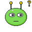
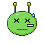
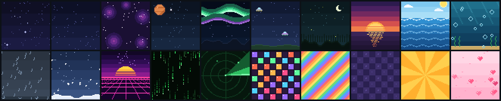

<div align="center">
  

  <br><br>

  
  
  
  
  
  
  

  <sub>esse é o zorp, o mascote. ele aparece por aí.</sub>

  <br><br>

  **[▸ testar com o seu nome](https://zrdep.github.io/alienzinhos/)**
</div>

<br>

###  sobre

```txt
uma seed entra, um alien sai.
mesma seed, mesmo alien. sempre.

10 rostos · 20 paletas · 10 bocas · 29 extras
20 olhos · 20 chapéus (metade animada)
20 fundos animados
+40 bilhões de combinações
```

###  uso

```bash
GET /alien/:seed                # svg do alien (com fundo)
GET /alien/:seed?tamanho=512    # 16 a 1024 · padrão 256
GET /alien/:seed?fundo=nao      # sem fundo, transparente
```

como a resposta é uma imagem, dá pra colocar em qualquer lugar:

```md

```

###  fundos



```txt
espaco-estrelas · estrelas-cadentes · nebulosa · planeta-orbita
aurora · ovnis · vaga-lumes · por-do-sol · oceano · bolhas
chuva · neve · synthwave · codigo-verde · radar
pista-disco · arco-iris · xadrez · raios-sol · coracoes
```

todo alien ganha um fundo. ele é sorteado por último, então quem já tinha um alien continua com o mesmo, só que agora com fundo.

###  rodando

```bash
git clone https://github.com/zrdep/alienzinhos.git
cd alienzinhos
npm i && npm run dev

# → http://localhost:3000/alien/zrdep
```

###  como funciona

```txt
seed ─► hash ─► sorteio ─┬─ rosto + paleta
                         ├─ boca
                         ├─ olhos
                         ├─ extras
                         ├─ chapéu
                         └─ fundo
                              │
                              ▼
                         svg 64×64
```

as camadas são empilhadas nessa ordem, com o fundo indo lá pra trás. as animações rodam só com css dentro do svg.

###  estrutura

```txt
assets/      svgs de cada camada
data/        paletas e metadados
docs/        banner, zorp e grade
pagina/      css e js da página de teste
src/         api
index.html   página de teste (github pages)
```

###  peças novas

toda peça é desenhada numa grade de 64×64 com zonas fixas pra olhos, boca e chapéu. use o [`docs/guia-grade.svg`](docs/guia-grade.svg) como camada de referência no editor.

<br>

<div align="center">
  
  <br>
  <sub><a href="LICENSE">MIT</a> · feito por <a href="https://github.com/zrdep">zrdep</a></sub>
</div>
